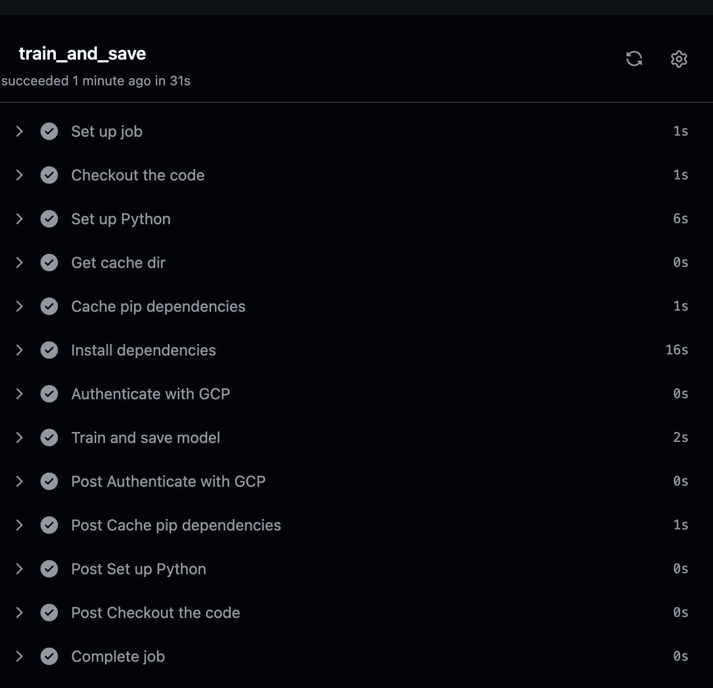
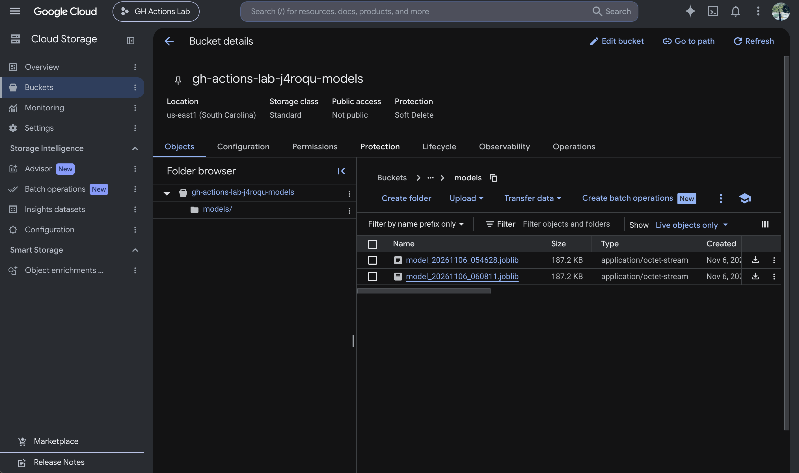
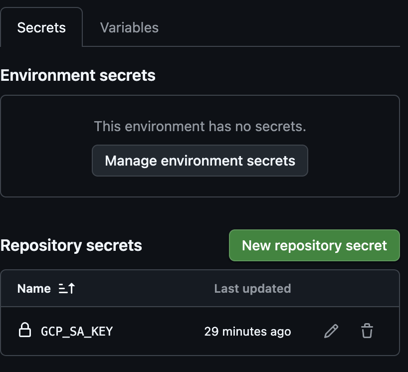

# Lab 3: GitHub Actions and GCP Connections

## Overview

In this lab I automated a small ML training pipeline with GitHub Actions and Google Cloud Platform. A workflow compares three classifiers on the Wine dataset using cross-validation, keeps the best one, evaluates it on a held-out test set, authenticates to GCP with a service account, and uploads both the trained model and a JSON metrics report to a Google Cloud Storage bucket. It runs on a daily schedule and can also be triggered manually.

Based on the MLOps course lab: [Labs/Github_Labs/Lab3](https://github.com/raminmohammadi/MLOps/tree/main/Labs/Github_Labs/Lab3), using the [template repository](https://github.com/AshyScripts/github-actions-gcp-beginner-lab) as the starting point.

## My Setup

| Item | Value |
|---|---|
| GCP project ID | `<PROJECT_ID>` |
| Service account | `gh-actions-sa@<PROJECT_ID>.iam.gserviceaccount.com` |
| Service account role | `roles/storage.admin` |
| GCS bucket | `gh-actions-lab-j4roqu-models` |
| Bucket location | `us-east1` (single region, uniform bucket-level access) |
| GitHub secret | `GCP_SA_KEY` (service account JSON key) |
| Workflow file | `.github/workflows/train-and-upload.yml` |
| Python (CI) | 3.10 |

## Architecture

```
 daily cron (00:00 UTC) / manual workflow_dispatch
                 |
                 v
   GitHub Actions runner (ubuntu-latest)
                 |
   checkout -> setup Python 3.10 -> restore pip cache -> install deps
                 |
                 v
   google-github-actions/auth@v2  (uses secrets.GCP_SA_KEY)
                 |
                 v
   train_and_save_model.py
     - load Wine, stratified 80/20 split
     - 5-fold CV: random forest, logistic regression, gradient boosting
     - refit the best model, evaluate on the test set
     - print comparison table and test metrics
                 |
                 v
   gs://gh-actions-lab-j4roqu-models/
     ├── models/model_YYYYMMDD_HHMMSS.joblib
     └── metrics/metrics_YYYYMMDD_HHMMSS.json   (same timestamp)
```

## Project Structure

```
.
├── .github/workflows/train-and-upload.yml   # CI workflow
├── train_and_save_model.py                  # select, train, evaluate, upload
├── requirements.txt
└── .gitignore
```

## Steps to Reproduce

1. **Clone and set up the environment**
   ```bash
   git clone https://github.com/nikhilsk98/gh-actions-gcp-beginner-lab.git
   cd gh-actions-gcp-beginner-lab
   python -m venv venv
   source venv/bin/activate
   pip install -r requirements.txt
   ```

2. **Test locally without uploading.** This saves `model.joblib` and `metrics.json` in the working directory. Both are git-ignored.
   ```bash
   SKIP_GCS_UPLOAD=1 python train_and_save_model.py
   ```

3. **Create GCP resources** (billing must be linked to the project)
   ```bash
   PROJECT_ID=<PROJECT_ID>
   BUCKET=<PROJECT_ID>-models
   gcloud config set project $PROJECT_ID
   gcloud services enable storage.googleapis.com iam.googleapis.com

   gcloud iam service-accounts create gh-actions-sa --display-name="GitHub Actions SA"
   gcloud projects add-iam-policy-binding $PROJECT_ID \
     --member="serviceAccount:gh-actions-sa@$PROJECT_ID.iam.gserviceaccount.com" \
     --role="roles/storage.admin"

   gcloud storage buckets create gs://$BUCKET --location=us-east1 --uniform-bucket-level-access

   mkdir -p ~/gcp-keys
   gcloud iam service-accounts keys create ~/gcp-keys/gh-actions-sa.json \
     --iam-account=gh-actions-sa@$PROJECT_ID.iam.gserviceaccount.com
   ```

4. **Add the key as a GitHub secret** (the key file stays outside the repo)
   ```bash
   gh secret set GCP_SA_KEY < ~/gcp-keys/gh-actions-sa.json
   gh secret list
   ```

5. **Point the workflow at the bucket.** Set `GCS_BUCKET_NAME` in the `env:` block of `.github/workflows/train-and-upload.yml`.

6. **Run and verify**
   ```bash
   gh workflow run train-and-upload.yml
   gh run watch
   gcloud storage ls gs://$BUCKET/models/ gs://$BUCKET/metrics/
   ```

## What I Changed from the Original Lab

### ML pipeline

- **Wine dataset instead of Iris.** I switched to scikit-learn's `load_wine` (178 samples, 13 chemical features, 3 cultivars). It's a little harder than Iris, and its features are on very different scales, which makes the comparison between scaled and unscaled models more interesting. The 80/20 train/test split is stratified by class with `random_state=42`.
- **Model selection with cross-validation.** Instead of training one fixed model, the script scores three candidates with stratified 5-fold CV on the training set only:
  - `RandomForestClassifier` (100 trees)
  - `LogisticRegression` (`max_iter=1000`) in a `Pipeline` with `StandardScaler`, so scaling is fit inside each fold and doesn't leak
  - `GradientBoostingClassifier`

  The candidate with the highest mean CV accuracy is refit on the full training set and evaluated once on the held-out test set. Ties go to the lower CV standard deviation, then to the earlier candidate in the list above.
- **Metrics report.** Each run produces a `metrics.json` with the dataset name, every model's CV mean and std, the chosen model, test accuracy, macro F1, the confusion matrix, and a UTC timestamp. The logs also show a short comparison table.
- **Metrics uploaded next to the model.** The model and its report share a timestamp (`models/model_<ts>.joblib` and `metrics/metrics_<ts>.json`), so every model in the bucket can be matched to the numbers that produced it.

### Infrastructure

- **Bucket name from an environment variable.** The template hardcoded the bucket. The script now reads `GCS_BUCKET_NAME` and falls back to a default, and the workflow sets it in its `env:` block.
- **Timestamped model versions.** Every run uploads to `models/model_YYYYMMDD_HHMMSS.joblib` (UTC), so earlier models are never overwritten.
- **In-memory upload.** The model is serialized to a `BytesIO` buffer and the metrics are uploaded as a string, so no temporary files are written on the runner.
- **Failed uploads fail the run.** Upload exceptions are not caught, so a GCS problem turns the workflow red instead of passing silently.
- **Local test mode.** `SKIP_GCS_UPLOAD=1` trains the model and saves the model and metrics locally, without needing GCP credentials.
- **Workflow matches the lab README.** I renamed the file to `train-and-upload.yml` and re-enabled the daily cron trigger, which was commented out in the template.
- **Pinned dependencies.** `requirements.txt` pins exact versions of pandas, scikit-learn, google-cloud-storage, numpy, scipy and joblib, taken from what CI installed on Python 3.10. This makes local and CI results match, and the pip cache key now changes only when I change a version on purpose.
- **Broader `.gitignore`.** It now covers JSON keys, `.env` files, and `*.joblib` / `*.pkl` model artifacts.

## Results

The manually triggered [workflow run](https://github.com/nikhilsk98/gh-actions-gcp-beginner-lab/actions/runs/42174480152) passed every step. Cross-validation results from that run (Python 3.10, scikit-learn 1.7.2):

| Model | 5-fold CV accuracy (mean ± std) |
|---|---|
| Random forest | **0.9791 ± 0.0277** (selected) |
| Logistic regression (scaled) | 0.9791 ± 0.0277 |
| Gradient boosting | 0.9094 ± 0.0990 |

Random forest and scaled logistic regression tied exactly on both mean and std, so the tie-break rule kept random forest because it comes first in the candidate list. Gradient boosting trailed, and its large std comes from one weaker fold.

Results for the chosen model on the held-out test set (36 samples):

| Metric | Value |
|---|---|
| Chosen model | `random_forest` |
| Test accuracy | **1.0000** |
| Test macro F1 | **1.0000** |
| Confusion matrix | `[[12, 0, 0], [0, 14, 0], [0, 0, 10]]` |

A perfect score on 36 test samples is plausible for Wine, but the CV estimate (about 0.98) is the more reliable measure of how the model generalizes.

Artifacts uploaded by this run:

```
gs://gh-actions-lab-j4roqu-models/models/model_20261106_062723.joblib
gs://gh-actions-lab-j4roqu-models/metrics/metrics_20261106_062723.json
```

Before I pinned dependencies, my local run with scikit-learn 1.9.1 gave gradient boosting 0.9236 instead of CI's 0.9094. After pinning `requirements.txt` to CI's versions, my local run (Python 3.11) and CI (Python 3.10) produce identical CV scores.

## Screenshots

### Successful GitHub Actions run


### GCS bucket contents


### GitHub secret configured (name only)


## Security Notes

- The service account key is stored only as the encrypted GitHub secret `GCP_SA_KEY` and in a local folder outside the repository. `*.json` is git-ignored as an extra safeguard.
- A better long-term approach is Workload Identity Federation (keyless auth from GitHub OIDC), which removes long-lived JSON keys entirely.
